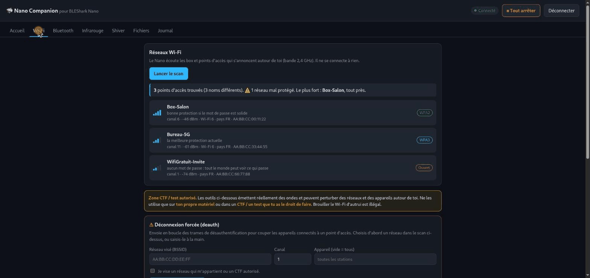
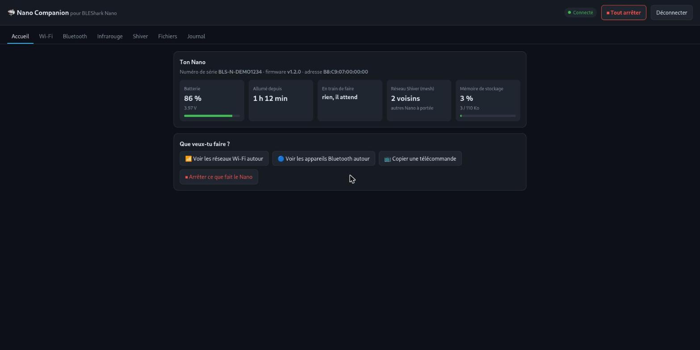
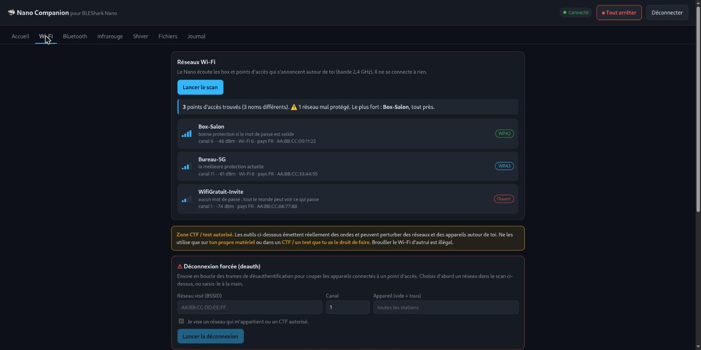
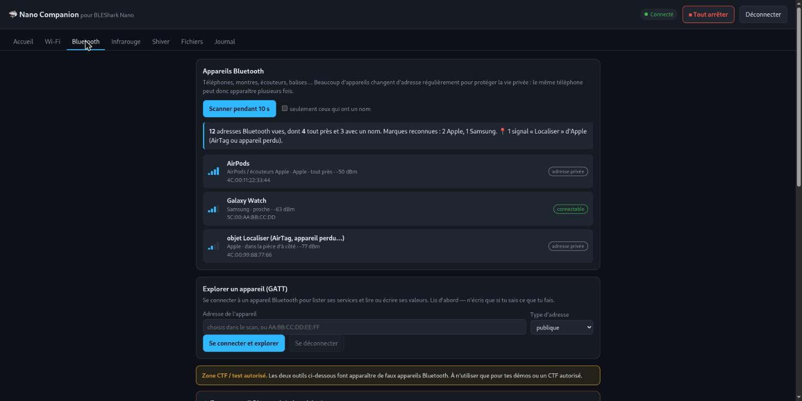
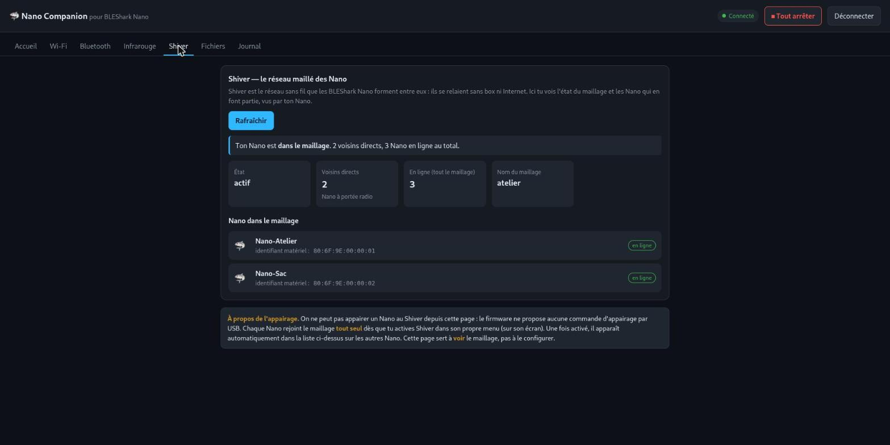

<div align="center">

# 🦈 Nano Companion

**Interface web tout-en-un pour le BLEShark Nano d'InfiShark — sans rien installer.**

[](https://driftware-dev.github.io/nano-companion/)
[](LICENSE)




👉 **[Ouvrir l'application](https://driftware-dev.github.io/nano-companion/)**

</div>

---

Nano Companion se branche sur le BLEShark Nano en USB directement depuis **Chrome** et
traduit en langage clair ce qu'il fait. Pensée pour être prise en main sans connaissances
techniques, tout en exposant **toutes** les fonctions que le Nano peut exécuter.

- **Sur ordinateur** : Chrome ou Edge, Nano branché en USB-C (via Web Serial).
- **Sur smartphone Android** : Chrome, Nano branché en USB-C, autoriser l'accès USB
  (via WebUSB). *iPhone/iPad : impossible, iOS n'ouvre pas l'USB aux navigateurs.*

Tout se passe entre ton navigateur et le Nano : **rien n'est envoyé sur Internet.**

## Aperçu

| Accueil | Wi-Fi |
|---|---|
|  |  |
| **Bluetooth** | **Shiver (mesh)** |
|  |  |

## Fonctions

- **Accueil** — batterie, temps d'allumage, tâche en cours, réseau Shiver, stockage.
- **Wi-Fi** — scan des réseaux avec signal, distance et sécurité expliquée ; et, en zone
  avertie : déconnexion forcée (deauth), faux portail captif, capture en `.pcap`.
- **Bluetooth** — scan avec reconnaissance des marques et des objets (AirTag, AirPods…) ;
  explorateur GATT ; faux appareil (iBeacon / Eddystone) ; clavier HID automatique (BadBT / BadBLE).
- **Infrarouge** — capture et rejeu de télécommandes, TV-B-Gone (avec arrêt matériel).
- **Shiver** — état du réseau maillé que les Nano forment entre eux, et liste des nœuds.
- **Fichiers** — lecture de la mémoire du Nano.
- **Journal** — tout l'échange USB, pour apprendre.

Un bouton **⏹ Tout arrêter**, toujours visible, coupe n'importe quelle action en cours
(y compris une rafale TV-B-Gone, via un redémarrage matériel du Nano).

## ⚠️ Usage responsable

Plusieurs outils (deauth, portail, faux appareils Bluetooth, clavier HID, TV-B-Gone)
émettent réellement et peuvent perturber des réseaux et des appareils. Ils sont destinés
**uniquement** à ton propre matériel ou à un **CTF / test que tu es autorisé à faire**.
Chaque action sensible est verrouillée derrière une case d'autorisation. Brouiller le
réseau ou s'introduire dans les appareils d'autrui est illégal. Tu es seul responsable
de l'usage que tu en fais.

## Faire tourner en local

Projet 100 % statique (aucune dépendance, aucun build) :

```sh
python3 -m http.server 8095
# puis ouvrir http://127.0.0.1:8095 dans Chrome
```

Web Serial / WebUSB exigent un contexte sécurisé : `localhost` ou HTTPS (GitHub Pages convient).

## Crédits & licence

Le protocole USB du Nano est réimplémenté à partir du **SDK InfiShark** (GPL-3.0) —
voir [`NOTICE.md`](NOTICE.md). Projet indépendant, non affilié à InfiShark.

Licence : **GPL-3.0-only** (voir [`LICENSE`](LICENSE)).
